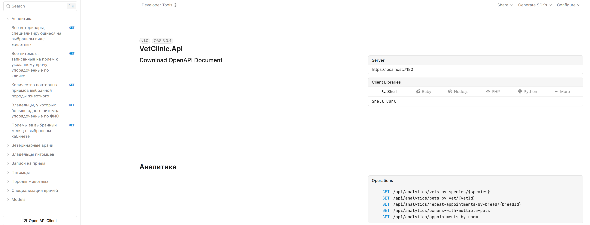
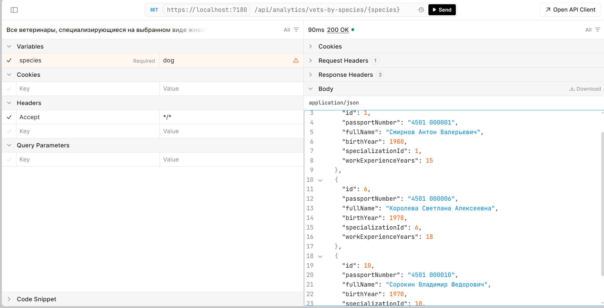
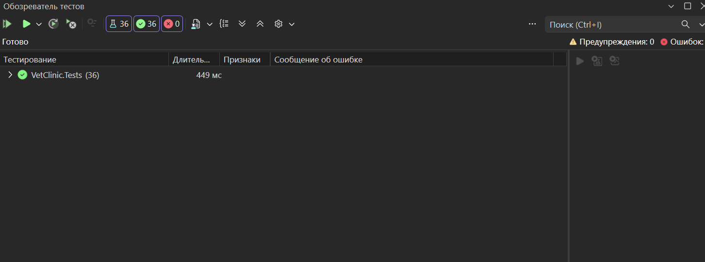

# Лабораторные 1-2 - Ветеринарная клиника

Ладыгин Денис Дмитриевич, группа 6411, вариант 10.

В лабе 1 реализована доменная модель ветклиники и unit тесты на LINQ-запросы из задания. 
В лабе 2 добавлен REST API на ASP.NET Core: CRUD для всех сущностей и запросы из лабы 1. Данные пока хранятся в памяти.

## Структура

- `VetClinic.Domain` - доменные классы, интерфейсы репозиториев и начальные данные
- `VetClinic.Infrastructure.InMemory` - репозитории, которые хранят данные в памяти
- `VetClinic.Contracts` - DTO и интерфейсы сервисов
- `VetClinic.Application` - сервисы и маппинг
- `VetClinic.Api` - контроллеры, обработка ошибок, Scalar
- `VetClinic.Tests` - unit тесты (xunit v3)

## Модель данных

- `Owner` - владелец: ФИО, адрес, телефон, список питомцев
- `Pet` - питомец: кличка, вид, порода, дата рождения, вес, владелец
- `Breed` - справочник пород с привязкой к виду животного
- `AnimalSpecies` - перечисление видов животных
- `Vet` - врач: паспорт, ФИО, год рождения, специализация, стаж
- `Specialization` - справочник специализаций, у общих специализаций вид не указан
- `Appointment` - запись на прием: дата и время, кабинет, питомец, врач, признак повторного приема

Начальные данные лежат в `VetClinic.Domain/Seeds`, их используют и API, и тесты.

## API

Для владельцев, питомцев, врачей, записей на прием, пород и специализаций есть: GET, GET {id}, POST, PUT {id} и DELETE {id} (`api/owners`, `api/pets`, `api/vets`, `api/appointments`, `api/breeds`, `api/specializations`).

Если запись не найдена, возвращается 404, если данные не прошли валидацию - 400. DELETE возвращает 204, даже если записи уже нет.
При удалении владельца удаляются его питомцы и их записи на прием, при удалении врача или питомца - их записи.
При удалении породы или специализации у питомцев и врачей она просто сбрасывается.

## Запросы

1. Все ветеринары, специализирующиеся на выбранном виде животных - `api/analytics/vets-by-species/{species}`
2. Все питомцы, записанные на прием к указанному врачу, по кличке - `api/analytics/pets-by-vet/{vetId}`
3. Количество повторных приемов выбранной породы - `api/analytics/repeat-appointments-by-breed/{breedId}`
4. Владельцы, у которых больше одного питомца, по ФИО - `api/analytics/owners-with-multiple-pets`
5. Приемы за месяц в выбранном кабинете - `api/analytics/appointments-by-room?roomNumber=&year=&month=`

## Запуск

```sh
cd VetClinic
dotnet run --project VetClinic.Api --launch-profile https
```

Документация API: https://localhost:7180/scalar/v1




## Запуск тестов

```sh
cd VetClinic
dotnet test --solution VetClinic.slnx
```

Тесты из лабы 1 проверяют запросы на начальных данных. В лабе 2 добавлены тесты сервисов:
те же запросы через сервис аналитики, а также создание, изменение и каскадное удаление.

### Результаты тестов

